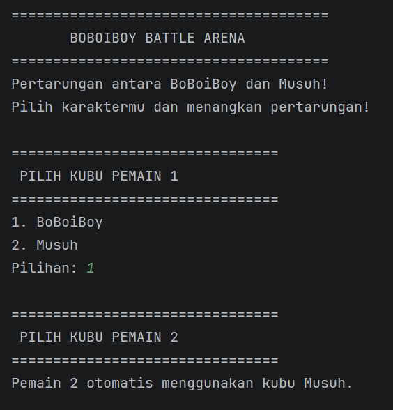
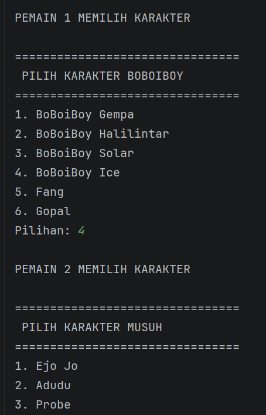
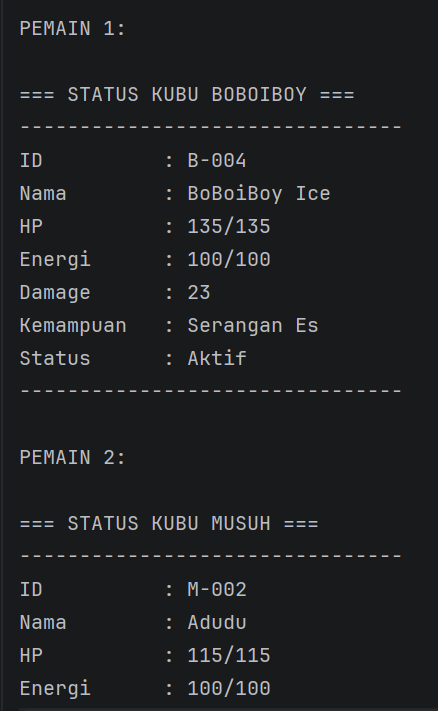
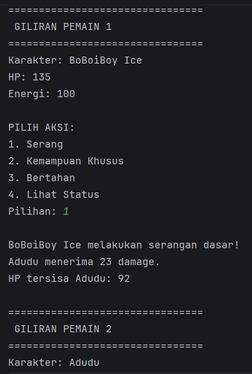
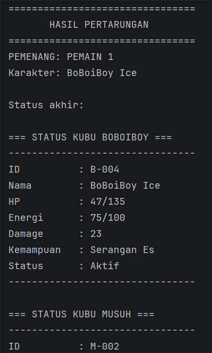

# BoBoiBoy Battle Arena

## Identitas

Nama: Irfan Satya Permana

NIM: H1D025121

Tema Sistem: Game

## Deskripsi Project

BoBoiBoy Battle Arena merupakan game pertarungan sederhana berbasis bahasa pemrograman Java yang dikembangkan dengan menerapkan konsep Object Oriented Programming (OOP).

Game ini mengusung mekanisme pertarungan 1 vs 1 antara dua kubu, yaitu kubu BoBoiBoy dan kubu Musuh. Setiap pemain dapat memilih satu karakter dari kubu yang berbeda untuk bertarung melawan pemain lainnya.

Kubu BoBoiBoy terdiri dari BoBoiBoy Gempa, BoBoiBoy Halilintar, BoBoiBoy Solar, BoBoiBoy Ice, Fang, dan Gopal.

Sementara itu, kubu Musuh terdiri dari Ejo Jo, Adudu, Probe, Retak'ka, dan Bora Ra.

Setiap karakter mempunyai statistik dan kemampuan khusus yang berbeda. Pemain dapat melakukan serangan dasar, menggunakan kemampuan khusus, serta melakukan pertahanan untuk mengurangi damage dari lawan.

Project ini dikembangkan untuk menerapkan sepuluh persyaratan konsep OOP dalam satu sistem permainan yang saling terintegrasi.

## Fitur Game

- Pemilihan kubu BoBoiBoy atau Musuh.
- Sistem pemilihan kubu yang berbeda untuk dua pemain.
- Pemilihan karakter berdasarkan kubu masing-masing.
- Sistem pertarungan 1 vs 1 berbasis giliran.
- Serangan dasar dengan damage berbeda.
- Kemampuan khusus setiap karakter.
- Sistem energi untuk penggunaan kemampuan khusus.
- Sistem pemulihan energi.
- Sistem pertahanan untuk mengurangi damage.
- Sistem HP dan penentuan pemenang.
- Tampilan status karakter selama pertarungan.

## Daftar Karakter

### Kubu BoBoiBoy

1. BoBoiBoy Gempa
2. BoBoiBoy Halilintar
3. BoBoiBoy Solar
4. BoBoiBoy Ice
5. Fang
6. Gopal

### Kubu Musuh

1. Ejo Jo
2. Adudu
3. Probe
4. Retak'ka
5. Bora Ra

## Konsep OOP yang Diimplementasikan

1. **State dan Behavior:** Penggunaan atribut karakter serta method prosedur dan fungsi.
2. **Immutability:** Penggunaan konstanta global `public static final` dan atribut instans `private final`.
3. **Enkapsulasi dan Overloading:** Penggunaan atribut private, getter, setter, keyword `this`, dan overloaded constructor.
4. **Inheritance:** Pewarisan superclass `Karakter` oleh subclass `KarakterBoBoiBoy` dan `KarakterMusuh`.
5. **Super Chaining:** Pemanggilan constructor superclass melalui `super()` dan method superclass melalui `super.namaMethod()`.
6. **Method Overriding:** Penimpaan method superclass menggunakan anotasi `@Override`.
7. **Abstract Class:** Penggunaan abstract class `Karakter` dan abstract method `gunakanKemampuan()`.
8. **Logika State Percabangan:** Penggunaan `if/else` untuk memeriksa dan mengubah state internal karakter.
9. **Polimorfisme Interface:** Pemanggilan method menggunakan variabel referensi bertipe interface.
10. **Multiple Interface:** Implementasi beberapa interface sekaligus dalam satu subclass.

## Struktur Folder

```text
BoBoiBoy-Battle-Arena/
├── .idea/
├── screenshots/
├── src/
│   ├── Bertahan.java
│   ├── GameConfig.java
│   ├── Karakter.java
│   ├── KarakterBoBoiBoy.java
│   ├── KarakterMusuh.java
│   ├── KemampuanKhusus.java
│   ├── Main.java
│   └── Penyerang.java
├── .gitignore
├── BoBoiBoy-Battle-Arena.iml
└── README.md
```

## Petunjuk Compile dan Run

### 1. Clone Repository

```bash
git clone https://github.com/Irfansatya/BoBoiBoy-Battle-Arena.git
```

### 2. Masuk ke Direktori Project

```bash
cd BoBoiBoy-Battle-Arena
```

### 3. Compile Program

Jalankan perintah berikut:

```bash
javac *.java
```

Perintah tersebut digunakan untuk mengompilasi seluruh file Java menjadi bytecode `.class`.

### 4. Jalankan Program

Setelah kompilasi berhasil, jalankan:

```bash
java Main
```

Program akan menampilkan menu pemilihan kubu, pemilihan karakter, dan mekanisme pertarungan 1 vs 1.

## Aturan Permainan

1. Pemain pertama memilih kubu BoBoiBoy atau Musuh.
2. Pemain kedua wajib memilih kubu yang berbeda.
3. Masing-masing pemain memilih satu karakter.
4. Kedua pemain melakukan pertarungan secara bergantian.
5. Pemain dapat memilih serangan dasar, kemampuan khusus, atau bertahan.
6. Karakter dengan HP mencapai 0 dinyatakan kalah.
7. Pemain yang karakternya masih memiliki HP menjadi pemenang.

## Dokumentasi Screenshot

### 1. Tampilan Awal dan Pemilihan Kubu



Keterangan: Menampilkan judul BoBoiBoy Battle Arena dan proses pemilihan kubu oleh Pemain 1 serta Pemain 2. Sistem memastikan kedua pemain tidak dapat memilih kubu yang sama.

### 2. Pemilihan Karakter



Keterangan: Menampilkan daftar karakter dari masing-masing kubu. Setiap pemain dapat memilih satu karakter sesuai kubu yang telah dipilih sebelumnya.

### 3. Tampilan Awal Pertarungan



Keterangan: Menampilkan karakter yang telah dipilih oleh kedua pemain, termasuk informasi HP, energi, damage serangan, dan kemampuan khusus.

### 4. Pengujian Aksi Pertarungan



Keterangan: Menampilkan proses pertarungan 1 vs 1 yang meliputi serangan dasar, penggunaan kemampuan khusus, pertahanan, dan perubahan status HP serta energi karakter.

### 5. Hasil Akhir Pertarungan



Keterangan: Menampilkan hasil pertarungan setelah salah satu karakter mencapai HP 0, termasuk informasi nama pemain dan karakter yang memenangkan pertandingan.
